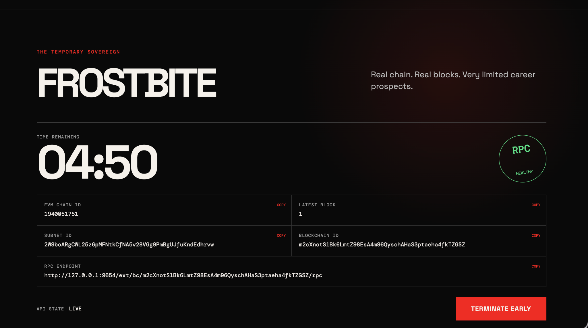
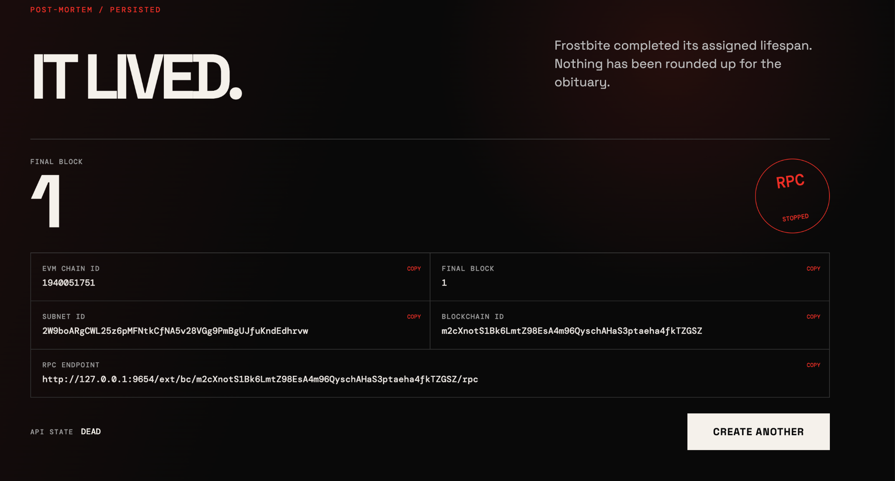

# thaw.fun

> Launch a disposable Avalanche L1 as easily as launching a meme coin.

thaw.fun turns "deploy a chain" into a one-click, self-destructing experience: pick a name, a symbol and a lifetime — a real Avalanche L1 is created from scratch, runs for exactly that long, then dies.

## What it does

Fill in three fields and press **Create**:

- **Name** — e.g. `Frostbite`
- **Symbol** — e.g. `FRST`
- **Lifetime (seconds)** — e.g. `300`

What follows is not a simulated progress bar:

```text
CREATING  → a real subnet + EVM blockchain is created and deployed via the Avalanche CLI
LIVE      → an L1 validator node is up and serving a real JSON-RPC endpoint
EXPIRING  → the lifetime you chose runs out — naturally, no manual kill required
DEAD      → the network is stopped, the RPC goes offline, the record is persisted
```

## Demo

Screenshots from a real end-to-end run on the isolated Local runtime (2026-09-30):

| LIVE — real chain, real blocks, countdown | DEAD — "IT LIVED." |
| --- | --- |
|  |  |

During LIVE the page shows the freshly created Subnet ID, Blockchain ID, EVM chain ID and RPC endpoint; after death the same identity is preserved with `RPC STOPPED`.

Demo video: coming with the hackathon submission.

## What actually happens under one click

```text
UI (Vue)
  └─ POST /chains
API (Fastify)
  └─ L1 Orchestrator — single-active-chain gate, persisted state machine
       CREATING → LIVE → EXPIRING → DEAD
     └─ Avalanche Adapter (Local)
          └─ Avalanche CLI: blockchain create / blockchain deploy --local
               └─ fresh Local Primary Network
                    ├─ Subnet ID
                    ├─ Blockchain ID (+ genesis, EVM chain ID)
                    └─ L1 validator node + JSON-RPC
                         ├─ eth_chainId verified against genesis
                         ├─ block growth proven with a real transaction
                         └─ LIVE is published only after every check passed
                              └─ natural expiry → avalanche network stop → DEAD (RPC offline)
```

No state is faked: `LIVE` appears only after deployment metadata, `eth_chainId` and transaction-backed block growth are verified; `DEAD` is recorded only after the network has actually stopped.

## Verified Local Demo

One real record from the isolated, disposable runtime (E2E PASS #1, 2026-09-30):

| Field | Value |
| --- | --- |
| Name / Symbol / Lifetime | Frostbite / FRST / 300 s |
| API record ID | `05fbdb15-1e3e-47c0-a8a8-327c36c0e807` |
| Subnet ID | `2W9boARgCWL25z6pMFNtkCfNA5v28VGg9PmBgUJfuKndEdhrvw` |
| Blockchain ID | `m2cXnotS1Bk6LmtZ98EsA4m96QyschAHaS3ptaeha4fkTZGSZ` |
| EVM Chain ID | `1940051751` (`0x73a2d727`) |
| RPC during LIVE | `http://127.0.0.1:9654/ext/bc/m2cXnotS1Bk6LmtZ98EsA4m96QyschAHaS3ptaeha4fkTZGSZ/rpc` — answered `eth_chainId` and `eth_blockNumber = 0x1` live from an independent terminal |
| Expiry | natural — scheduler fired at `expiresAt`; no manual termination |
| Final state | `DEAD`, final block `1`, RPC stopped, record persisted with `expiredAt` |

A second, fully independent round on a freshly re-initialized runtime completed the same natural lifecycle (Blockchain ID `2AZwb9r6CyRJ8bGK7hjshTqkTVn6ay98decBDMKbip1znEBCUK`, EVM chain ID `1362636274` — repository records). Each round runs on its own disposable Primary Network; the demo runtime never reads or writes historical chain state and is removable as one unit.

## Current scope

- **This submission: a reproducible Local Avalanche L1 lifecycle** — real infrastructure (subnet, blockchain, validator, JSON-RPC), a real lifecycle and a real death.
- **Fuji (testnet): prepared, not claimed.** The Fuji adapter, L1 conversion, genesis tooling and host-control scripts are in the repository and unit-tested, but a full public Fuji E2E has not been executed and is explicitly not part of this submission.

## Why Avalanche

thaw.fun is not merely deployed *on* Avalanche — it launches *Avalanche L1 infrastructure*. A meme-coin launch normally deploys one contract onto a shared chain; thaw.fun provisions an entire L1 — its own subnet, its own blockchain, its own validator — as the launch itself. Avalanche's subnet architecture is what makes a per-project chain cheap enough to create and acceptable to destroy: the chain is the product, and the product is intentionally mortal.

## Architecture

```text
apps/web   Vue UI (create form, LIVE countdown, post-mortem, refresh/restart recovery)
apps/api   Fastify API → L1Orchestrator → Local/Fuji Avalanche adapters → CommandRunner / JSON-RPC
```

- State machine: `CREATING → LIVE → EXPIRING → DEAD` (`DEAD`/`FAILED` terminal), persisted in an atomic JSON repository; `requiresRecovery` is set before any external mutation so a failed deploy can never silently free the slot.
- Chain records: `apps/api/src/json-chain-repository.ts` (temp-file + rename, atomic).
- Adapter contract: `apps/api/src/domain.ts`; Local adapter: `apps/api/src/local-avalanche-adapter.ts`.

Details: [docs/L1_ORCHESTRATOR.md](docs/L1_ORCHESTRATOR.md) · Local validation history: [docs/LOCAL_VALIDATION.md](docs/LOCAL_VALIDATION.md) · Full UI acceptance run (2026-09-20): [UI_ACCEPTANCE_REPORT.md](UI_ACCEPTANCE_REPORT.md) · Demo operations manual: [docs/DEMO_LOCAL_RUNBOOK.md](docs/DEMO_LOCAL_RUNBOOK.md)

## Run the Local Demo

Prerequisites: macOS (Apple Silicon), Node.js 20+, pnpm 10, [Avalanche CLI](https://github.com/ava-labs/avalanche-cli) v1.9.6 on your `PATH`, Foundry `cast`.

```bash
pnpm install
./scripts/demo-up.sh      # fresh isolated Local Primary Network + API + UI, with readiness checks
# open http://127.0.0.1:5173 — fill Name / Symbol / Lifetime — press Create
./scripts/demo-down.sh    # stop Web, API and the network
./scripts/demo-reset.sh   # wipe the disposable runtime (mandatory between rounds)
```

The demo toolchain runs the CLI against an isolated state root (`RUN_CLI_E2E`) with a dedicated chain repository, refuses to start on a dirty runtime (busy ports, leftover snapshot, CLI version drift), and asserts the Primary Network is brand-new (exactly X-Chain + C-Chain) before any Create is possible. Full manual and troubleshooting: [docs/DEMO_LOCAL_RUNBOOK.md](docs/DEMO_LOCAL_RUNBOOK.md).

## Repository layout

| Path | What it is |
| --- | --- |
| `apps/web` | Vue UI: create form, LIVE countdown, post-mortem |
| `apps/api` | Fastify API, orchestrator, state machine, Local/Fuji adapters, unit tests |
| `packages/shared` | Shared disposable-L1 types |
| `scripts/demo-*.sh` | Disposable Local demo toolchain (up / down / reset / guarded CLI wrapper) |
| `contracts` | Foundry example contract + tests |
| `docs` | Runbooks, architecture notes and dated validation evidence |
| `infra` | Single-VPS deployment templates (future scope) |

## Roadmap (future work — not part of this submission)

- Funded Fuji creation with a connected Core wallet
- Tokenomics templates, genesis allocation, governance presets
- Validator economics
- Public Fuji / Mainnet workflows, VPS-hosted validator infrastructure
